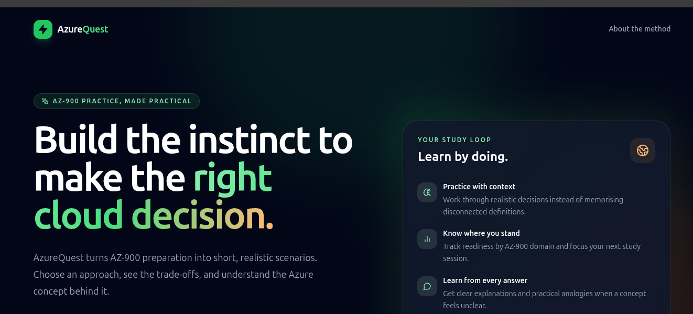
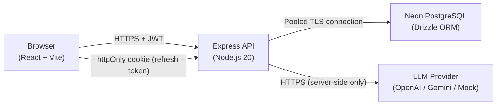

# AzureQuest — AZ-900 Scenario Lab

> **Unofficial study tool. Not affiliated with or endorsed by Microsoft.**

*"Most AZ-900 tools test what you remember. AzureQuest tests whether you can decide, then explains in terms a Kenyan learner already knows."*

## What is AzureQuest?

AzureQuest is an original, scenario-based learning platform for the [Microsoft Azure Fundamentals (AZ-900)](https://learn.microsoft.com/en-us/credentials/certifications/azure-fundamentals/) certification. Instead of flashcard definitions, it presents realistic East African business situations — a Kenyan university under registration-week load, a SACCO securing member data, a Nairobi retailer during a Black Friday spike — and asks you to make the cloud architecture decisions a real engineer would face.

When you get something wrong, an AI Tutor explains the technical reason using an African analogy (matatus, M-Pesa bundles, SACCOs, market stalls), and offers the same explanation in Kiswahili.

## Screenshots



## Architecture



**Frontend:** React 18 + TypeScript + Vite + Tailwind CSS, deployed on Vercel.  
**Backend:** Node.js 20 + Express + TypeScript, deployed on Render/Railway.  
**Database:** Neon serverless PostgreSQL (pooled connection), Drizzle ORM migrations.  
**Auth:** Custom JWT auth (no third-party auth service). Refresh tokens stored hashed in DB.  
**AI:** Provider-agnostic `LLMClient` interface — swap providers via env vars. AI never grades; all grading is deterministic from human-verified answer keys.

## Features

- 🎯 **7 original scenarios** across all 3 AZ-900 domains, set in East African contexts
- ⚡ **Instant guest mode** — start learning with no sign-up
- 📊 **Readiness estimate** with per-domain scores and AZ-900 exam weights
- 🤖 **AI Tutor** — explanations in English and Kiswahili, with East African analogies
- 🔁 **Leitner flashcards** — Spaced repetition for missed concepts
- 🧠 **Misconception tracking** — alerts when you confuse the same pair of concepts repeatedly
- 🔐 **Security-first** — argon2 passwords, hashed refresh tokens, answer keys never exposed before submission

## AZ-900 Domain Weights (verified October 2024)

| Domain | Exam Weight | AzureQuest Midpoint |
|--------|-------------|---------------------|
| Cloud Concepts | 25–30% | 27.5% |
| Azure Architecture & Services | 35–40% | 37.5% |
| Azure Management & Governance | 30–35% | 32.5% |

Source: [AZ-900 skills outline on Microsoft Learn](https://learn.microsoft.com/en-us/credentials/certifications/resources/study-guides/az-900) — verify this link for the most current weights.

## Quick Start

### Prerequisites
- Node.js 20+
- A [Neon](https://neon.tech) account (free tier works)
- An LLM API key (optional — use `LLM_PROVIDER=mock` for offline dev)

### 1. Clone and install

```bash
git clone <repo-url>
cd azurequest
npm install
```

### 2. Set up Neon

1. Create a Neon project at [neon.tech](https://neon.tech)
2. Create two branches: `main` (production) and `dev` (development)
3. Copy the **pooled** connection string (the host ending in `-pooler`)

### 3. Configure environment variables

```bash
# API
cp apps/api/.env.example apps/api/.env
# Edit apps/api/.env with your DATABASE_URL, JWT_SECRET, REFRESH_SECRET, etc.

# Web
cp apps/web/.env.example apps/web/.env
# Edit apps/web/.env — for local dev the default (http://localhost:3001) works
```

Generate secrets:
```bash
node -e "console.log(require('crypto').randomBytes(64).toString('hex'))"
```

### 4. Run database migrations and seed

```bash
npm run db:generate    # Generate migration files from schema
npm run db:migrate     # Apply migrations to Neon
npm run db:seed        # Seed concepts and 7 scenarios (idempotent — safe to re-run)
```

### 5. Start development servers

```bash
npm run dev    # Starts API on :3001 and Web on :5173 concurrently
```

Visit [http://localhost:5173](http://localhost:5173)

## Available Scripts

| Script | Description |
|--------|-------------|
| `npm run dev` | Start API + Web in dev mode |
| `npm run build` | Production build (all packages) |
| `npm run lint` | ESLint all packages |
| `npm run typecheck` | TypeScript typecheck all packages |
| `npm run test` | Run all unit tests (Vitest) |
| `npm run db:generate` | Generate Drizzle migrations |
| `npm run db:migrate` | Apply migrations to the database |
| `npm run db:seed` | Seed all concepts and scenarios (idempotent) |
| `npm run db:cleanup-guests` | Delete inactive guest accounts (30+ days) |

## Environment Variables

### `apps/api/.env`

| Variable | Required | Description |
|----------|----------|-------------|
| `DATABASE_URL` | ✅ | Neon **pooled** connection string |
| `JWT_SECRET` | ✅ | 64-byte random hex for access tokens |
| `REFRESH_SECRET` | ✅ | 64-byte random hex for refresh tokens |
| `CORS_ORIGINS` | ✅ | Comma-separated list of allowed origins |
| `LLM_PROVIDER` | ✅ | `openai` / `google` / `mock` |
| `LLM_API_KEY` | ✓ if not mock | Your LLM provider API key |
| `LLM_MODEL` | ✓ if not mock | e.g. `gpt-4o-mini` or `gemini-1.5-flash` |
| `PORT` | — | Default: 3001 |
| `NODE_ENV` | — | `development` / `production` |

### `apps/web/.env`

| Variable | Required | Description |
|----------|----------|-------------|
| `VITE_API_URL` | ✅ (prod) | Production API URL (blank in dev — Vite proxy used) |

## Deployment

### Frontend (Vercel)

1. Connect your GitHub repo to Vercel
2. Set root directory to `apps/web`
3. Build command: `npm run build`
4. Output directory: `dist`
5. Add `VITE_API_URL` env var pointing to your API

### Backend (Render / Railway)

1. Connect your GitHub repo
2. Root directory: `apps/api`
3. Build command: `npm install && npm run build`
4. Start command: `node dist/server.js`
5. Add all env vars from `apps/api/.env.example`

> **⚠️ Warm-up before demo:** Both Render (free tier) and Neon suspend when idle. Before presenting, hit `GET /api/health` a few minutes early to wake both up. The frontend shows a "Waking up the server…" banner while the first request is slow.

## Security

- Answer keys (`isCorrect`, `mistakeType`, `confusedWithConceptId`) are **never sent to the client** before submission — stripped server-side before every API response.
- All user-owned data goes through a repository layer that requires `userId` and always filters by it — preventing cross-user data access without Row Level Security.
- Refresh tokens are stored **hashed** (SHA-256) in the database and can be individually revoked.
- LLM API keys are **server-side only** and never exposed to the frontend.

## Content Verification Process

See [docs/content-guidelines.md](docs/content-guidelines.md).

All seeded scenarios are original and aligned with the public AZ-900 skills outline. Items marked `// VERIFY against Microsoft Learn` in the seed file should be reviewed against the official documentation before publishing. Items marked `// TODO: human review` on analogies need a Swahili speaker to review accuracy.

## Known Limitations

- The readiness estimate weights may not exactly match current Microsoft scoring — they are based on the public exam weight ranges and a declared heuristic. See the in-app disclaimer.
- AI-generated practice scenarios (via `/tutor/practice`) are flagged as unverified and do not count toward readiness scores.
- The Results page (`/results/:attemptId`) is a placeholder; a dedicated `GET /attempts/:id/summary` endpoint would add richer post-attempt analysis (future phase).
- Neon free tier may have a cold start of 5–15s after idle periods.

## Disclaimer

**Unofficial study tool. Not affiliated with or endorsed by Microsoft Corporation. AZ-900 is a registered certification of Microsoft. All content is original and based only on the publicly available AZ-900 skills outline on Microsoft Learn.**
